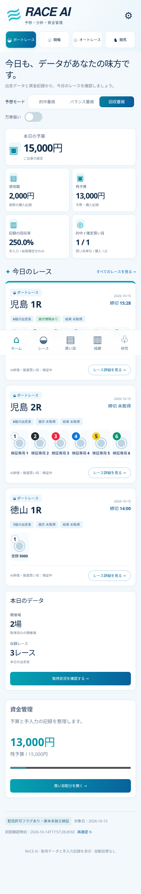
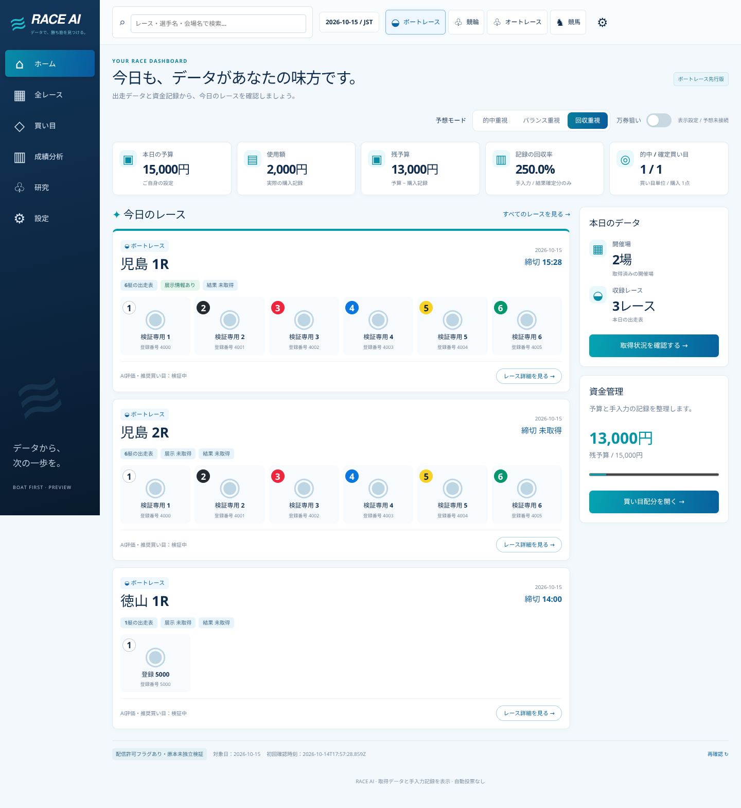

# UI evidence — 2026-10-15 JST

These are synthetic browser-test screenshots, not live race data or validated AI performance. Source code snapshot: UI 9edbbe214d49388ab8757dea50233a1795acea1f, local integration 8672a9b with auth + Worker + UI. Command: FONTCONFIG_PATH=/tmp/fonts RACE_UI_CHROMIUM_PACKAGE=<installed @sparticuz/chromium> node tests/ui_browser.test.js.

Chromium completed navigation and interaction for seven views at 1440x1000, 390x844 and 320x740, including venue selection, filters, manual tickets/records/settlement, point-limit lowering, current-date validation, future/unauthorized/stale feed refusal, refresh races and JST rollover. No document overflow or page errors observed. Python integration suite: 193 tests OK, 1 existing OpenCV skip.

Eight supplied reference images were individually inspected in the UI lane. White/light blue/navy/teal layout, desktop sidebar and secondary panel, mobile bottom navigation and compact cards are implemented. Licensed racer portraits, photographic header, validated AI suggestions and actual data remain absent; this is not full visual acceptance. Real iPhone Safari and live E2E remain unverified. Manual synthetic payout figures in these images are not RACE AI prediction results.

## Phone home

## Desktop home

